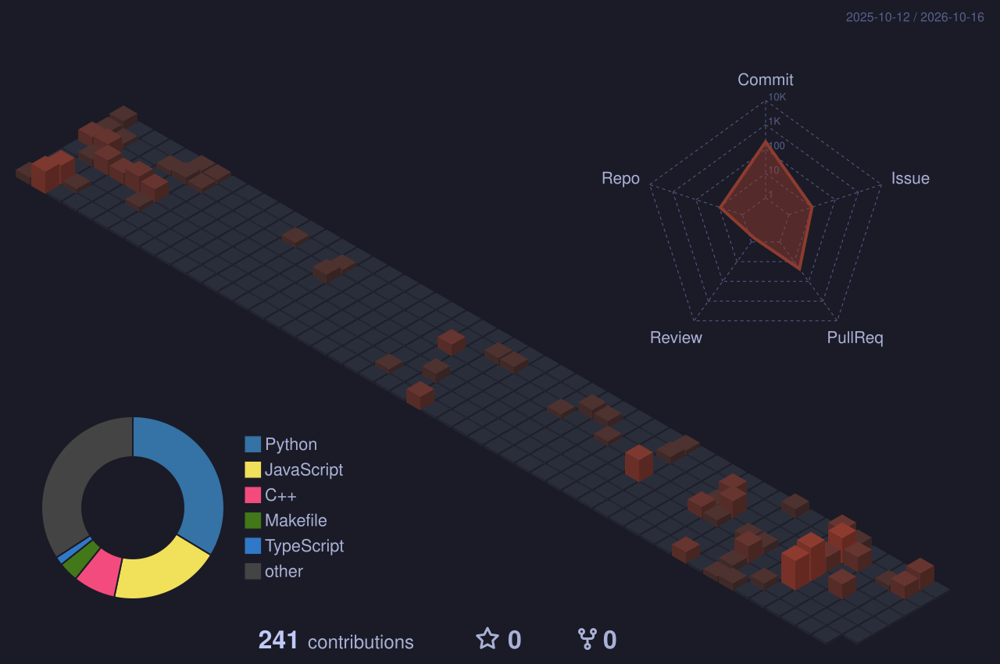

<p align="center">
  
</p>

<p align="center">
  Estudante de Engenharia de Software na UnB (previsão 2027) e estagiário backend Django no Senado Federal (SECOM/COTI).<br/>
  Meu caminho é Engenharia de IA: construo o backend e a camada de IA que roda em cima dele.
</p>

---

### Minhas contribuições, em 3D

<p align="center">
  
</p>

<table align="center" width="100%">
<tr>
<td align="center" valign="middle" width="40%">

```text
⠀⠀⠀⠀⠀⠀⠀⠀⢀⣀⣤⣶⣶⣶⣤⣄⣀⣀⣀⣀⣠⣀⣀⠀⠀⠀⠀⠀⠀⠀⠀⠀⠀⠀
⠀⠀⠀⠀⠀⠀⠀⠀⣾⣿⣿⣿⣿⣿⣿⣿⣿⣿⣿⣿⣿⣿⣿⣿⣿⣶⣶⡠⠀⠀⠀⠀⠀⠀
⠀⠀⠀⠀⠀⠀⠀⠀⣿⣿⣿⣿⣿⣿⣿⣿⣿⣿⣿⣿⣿⣿⣿⣿⣿⣿⣿⡇⠀⠀⠀⠀⠀⠀
⠀⠀⠀⠀⠀⠀⠀⠀⣿⠿⠿⠿⢿⣿⣿⣿⣿⣿⣿⣿⣿⡿⠿⠿⠛⠻⠿⠃⠘⠂⠀⠀⠀⠀
⠀⠀⠀⠀⠀⠀⠀⠀⢀⣤⣤⣤⣤⣄⡙⢻⣿⣿⣿⠋⣀⣤⣴⣶⣶⣦⣤⠀⠀⠀⠀⠀⠀⠀
⠀⠀⠀⠀⠀⠀⠀⣰⡿⠋⠉⠉⠉⣀⠬⠙⢿⣿⠟⢻⠟⣉⠉⠉⡁⠉⣿⣧⠀⠀⠀⠀⠀⠀
⠀⠀⠀⢰⠆⠀⠀⣿⣧⣶⣿⣶⣶⣷⣶⠀⢸⣿⠀⢘⣷⣾⣷⣶⣿⣶⣿⣿⠀⠀⠀⡴⢢⠀
⠀⠀⠀⢎⡇⠀⢠⣿⣿⣿⣿⣿⣿⣿⡏⠀⣸⣿⡀⠈⣿⣿⣿⣿⣿⣿⣿⣿⡇⠀⠀⣯⣘⠀
⠀⠀⠀⢸⠇⠀⠘⢰⣿⣿⣿⣿⣿⡟⢁⣴⣿⣿⣷⣄⣌⢻⣿⣿⣿⣿⣿⣟⡇⠀⠀⠿⢿⠀
⠀⠀⠀⠘⣆⠀⢀⠸⣿⣿⣿⣿⣿⡷⠀⠀⠈⣏⠤⠄⠠⠼⣿⣿⣿⣿⣿⡿⡇⠀⣰⡶⠀⠀
⠀⠀⠀⠀⠈⠀⠀⣄⢻⡟⠐⠋⠀⠀⠀⠠⠴⠷⠦⠄⠀⠀⠀⡈⠛⣻⣿⣷⡇⠀⠉⠀⠀⠀
⠀⠀⠀⠀⠀⠀⠀⢿⡌⣿⣾⣦⡀⠀⢶⣶⣿⣷⣿⣾⠶⠂⢀⣴⣷⣿⣿⣿⠃⠀⠀⠀⠀⠀
⠀⠀⠀⠀⠀⠀⠀⠈⢷⠘⠿⣿⣿⣦⣄⣀⣩⣭⣭⣤⣤⣶⣿⣿⡿⢻⡟⠃⠀⠀⠀⠀⠀⠀
⠀⠀⠀⠀⠀⠀⠀⠀⠀⠁⠀⠘⣿⣿⣿⣿⣿⣿⣿⣿⣿⣿⣿⡿⠀⠘⠁⠀⠀⠀⠀⠀⠀⠀
⠀⠀⠀⠀⠀⠀⠀⢸⣀⠀⠀⠀⠹⣿⣿⣿⣿⣿⣿⣿⣿⣿⡿⠃⠀⠀⣠⠀⠀⠀⠀⠀⠀⠀
⠀⠀⠀⠀⠀⠀⠀⢸⣿⡁⠀⠀⠀⠘⠿⣿⡿⡿⣿⣿⡿⠟⠁⠀⢀⣼⡿⠀⠀⠀⠀⠀⠀⠀
⠀⠀⠀⠀⠀⠀⠀⢸⣿⣷⣦⣀⠀⠀⠀⠀⠀⠀⠀⠀⠀⠀⢀⣶⣿⣿⡇⠀⠀⠀⠀⠀⠀⠀
⠀⠀⠀⠀⠀⢀⠀⣾⣿⣿⣿⣿⣷⡶⣶⣷⣶⣷⣶⣶⣶⣶⣿⣿⣿⣿⡿⠀⠀⠀⠀⠀⠀⠀
⠀⠀⠀⠀⠀⡿⠀⣿⣿⣿⣿⣿⣿⣿⣿⣿⣿⣿⣿⣿⣿⣿⣿⣿⣿⣿⡏⠀⢀⠀⠀⠀⠀⠀
⠀⣴⣶⡀⠀⢡⣴⣿⣿⣿⣿⣿⣿⣿⣿⣿⣿⣿⣿⣿⣿⣿⣿⣿⣿⣿⡇⢸⣼⠀⠀⠀⠀⠀
```

</td>
<td align="center" valign="middle" width="60%">



</td>
</tr>
</table>

---

### Projetos

#### Backend

<table align="center" width="100%">
<tr>
<td>

**[imoveldf-vitrine](https://github.com/Acciolyy/imoveldf-vitrine)**
<br/>
<sub>Portal de imóveis full-stack em Django 5.2, PostgreSQL, HTMX e Docker. Código privado; este repo é um case study de arquitetura.</sub>

</td>
</tr>
<tr>
<td>

**[excalidraw](https://github.com/Acciolyy/excalidraw)**
<br/>
<sub>Contribuições open source em revisão no Excalidraw, projeto com mais de 130 mil estrelas.</sub>

</td>
</tr>
</table>

#### IA & Agentes

<table align="center" width="100%">
<tr>
<td>

**[agente-triagem-vagas](https://github.com/Acciolyy/agente-triagem-vagas)**
<br/>
<sub>Agente com Gemini API e function calling que tria vagas remotas por critérios em linguagem natural.</sub>

</td>
</tr>
<tr>
<td>

**[Cell-Detector](https://github.com/Acciolyy/Cell-Detector)**
<br/>
<sub>Visão computacional em tempo real com modelo Edge Impulse; pipeline otimizado de 10 para 30 FPS.</sub>

</td>
</tr>
<tr>
<td>

**[portfolio-ia](https://github.com/Acciolyy/portfolio-ia)**
<br/>
<sub>Busca, modelos probabilísticos e ML; CNN em PyTorch com 98,9% de acurácia.</sub>

</td>
</tr>
<tr>
<td>

**[Dashboard-Salarios](https://github.com/Acciolyy/Dashboard-Salarios)**
<br/>
<sub>Dashboard em Streamlit sobre mais de 130 mil registros, consumindo a API da Adzuna com cache de 24h.</sub>

</td>
</tr>
</table>

---

### Tech Stack

<table align="center" width="100%">
<tr>
<td align="center" width="33%">

**Backend**

<p align="center">
  
  
  
  
  
  
</p>

</td>
<td align="center" width="33%">

**IA**

<p align="center">
  
  
  
  
  
  
</p>

</td>
<td align="center" width="33%">

**Dados**

<p align="center">
  
  
  
  
</p>

</td>
</tr>
</table>

---

### GitHub Stats

<table align="center" width="100%">
<tr>
<td align="center" width="50%"></td>
<td align="center" width="50%"></td>
</tr>
</table>

---

### Agora

- Backend Django em produção no Senado Federal.
- IA aplicada: agentes, LLMs e avaliação de respostas.

---

### Contato

<p align="center">
  <a href="https://www.linkedin.com/in/thiago-viriato-accioly"></a>
  <a href="https://portfolio-thiago-beta.vercel.app/"></a>
</p>

---

> Antes de acreditar no número, vale perguntar o que exatamente ele está medindo.
